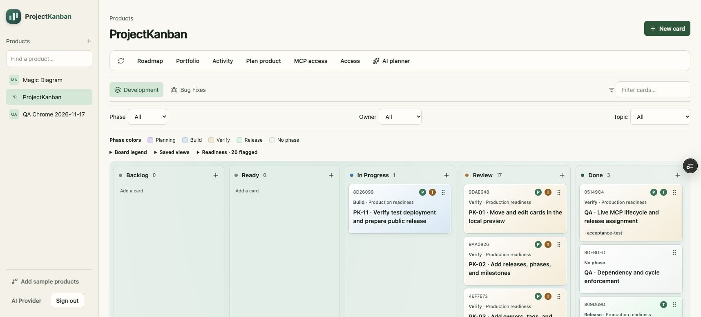
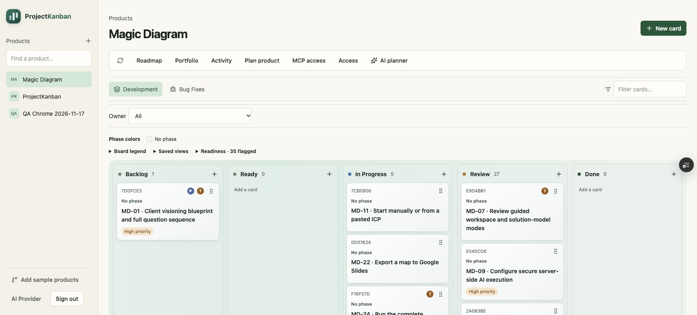

# Introducing ProjectKanban

## Main message

**One shared development plan for you and your AI coding tools.**

Keep the plan moving when the conversation changes.

## Short repository description

Open-source product planning for humans and AI coding tools. Shared roadmaps, development boards, bugs, and verification through MCP.

## Public project description

Building with AI gets harder when the work is spread across chats, tools, and computers. What did we agree to build? What changed? What still needs testing?

ProjectKanban gives those answers a shared home. It is an open-source workspace where you and connected coding tools can maintain product roadmaps, development tasks, bugs, and verification evidence. Connect Codex, Claude Code, or another MCP-compatible tool to your hosted installation, then carry the saved work from one session to the next.

## Founder introduction / LinkedIn draft

I have two Codex chats and two Claude Code chats, using different accounts on different computers.

That creates a practical problem: where does the current development plan live?

A feature starts in one conversation. Implementation happens in another. Testing uncovers something else. Before long, I am piecing together what was decided, what changed, and what still needs to happen.

That is why I built ProjectKanban.

It gives each product a roadmap, a development board, and a bug board. Connected AI coding tools can read and update the same work through MCP. Plans, acceptance criteria, test results, and supporting screenshots stay with the cards.

The goal is straightforward: make it easier to move between tools without rebuilding the project context every time.

I am using it to track ProjectKanban itself and Magic Diagram. The screenshots show those real projects, including work still in review.

The source is now public under the MIT license, with instructions for hosting your own installation on Vercel and Neon and connecting your coding tools.

It is still under active development. If you build across several AI tools, I would welcome feedback on what would make your handoffs clearer.

Explore the code and setup guide:
https://github.com/drdavis/ProjectKanban

## Images to use

Lead with the actual product. These screenshots were captured on November 21, 2026, with the owner's permission to show current developments. They show board titles, development tasks, and status indicators; no credentials or account settings are displayed.

### 1. Main product screenshot

**Caption:** One shared development plan. Roadmap phases, active work, review, and verification in ProjectKanban.

**Use:** GitHub introduction and the first image in a launch post. The phase colors and separate Review and Done columns reinforce that implementation and verification are different steps.

### 2. A second real product

**Caption:** Different products, separate plans. Magic Diagram's development work in the same ProjectKanban installation.

**Use:** Second carousel image or supporting image in a project article. It demonstrates that the workspace handles more than its own development backlog.

### 3. Suggested short demonstration

A 30–45 second screen recording would explain the cross-tool benefit better than another static dashboard image:

1. Open a card and show its intended outcome and acceptance criteria.
2. In a connected coding tool, request that same card through MCP.
3. Record a meaningful progress note or test result from the tool.
4. Refresh the board and show the saved update.

Use a clearly labeled demonstration card and keep tokens, terminal environment output, and account settings out of the recording. This is a proposed recording outline, not an existing demo asset.

## Keep the promise precise

Describe ProjectKanban as shared planning and execution records for humans and connected AI tools. MCP clients must be configured and instructed to read and update the board. Saved product data is centralized; conversations, unpublished browser drafts, saved views, and local source changes are not automatically shared.

Anyone can use the MIT-licensed source to host an installation. The public repository does not grant access to the author's private workspace or provide free hosted service. The built-in AI planner needs separate provider configuration. Avoid claims of automatic agent orchestration, automatic GitHub synchronization, or completed release certification.
